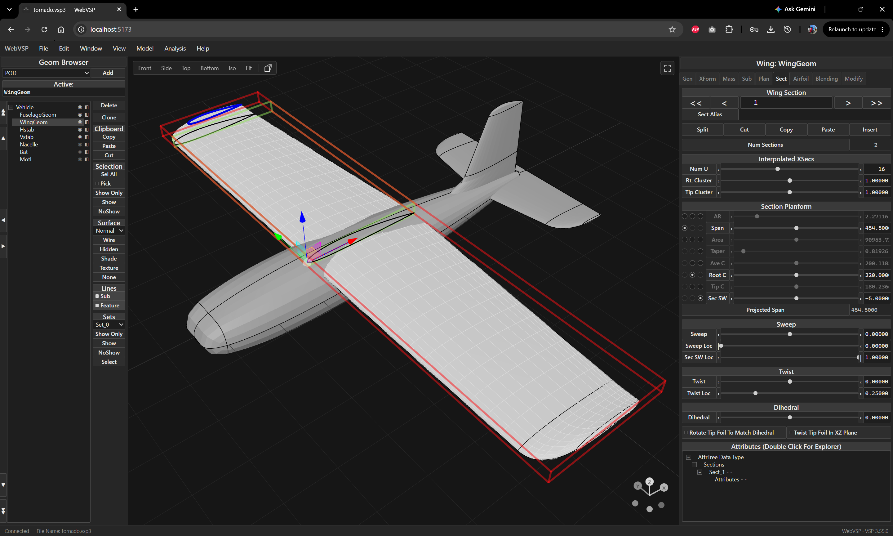
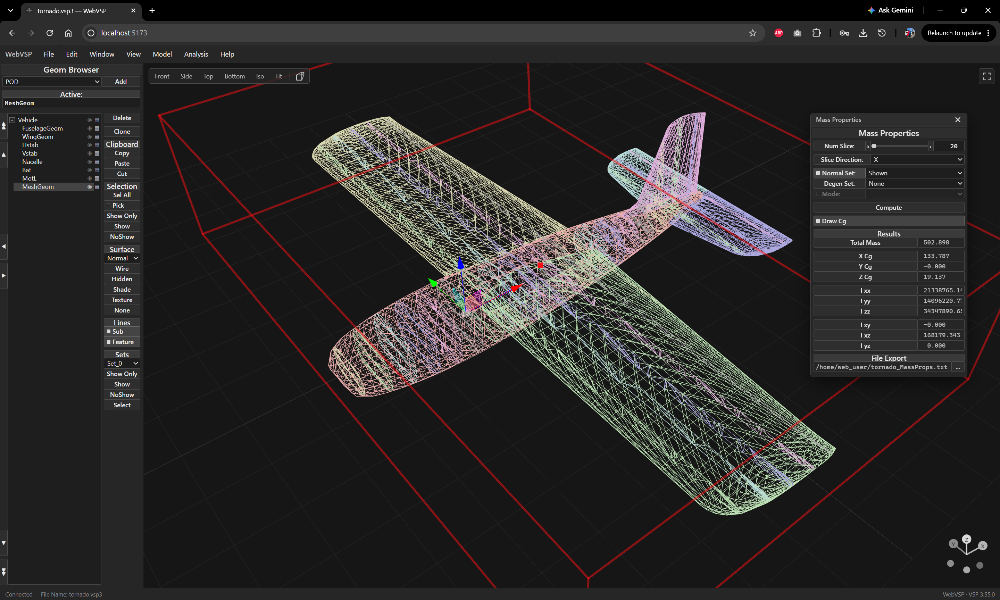
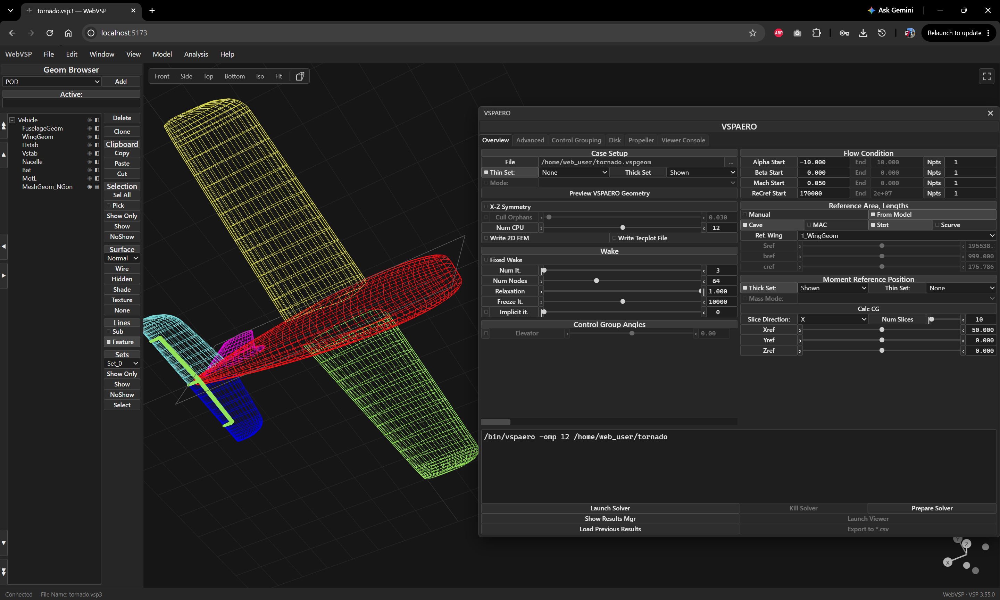
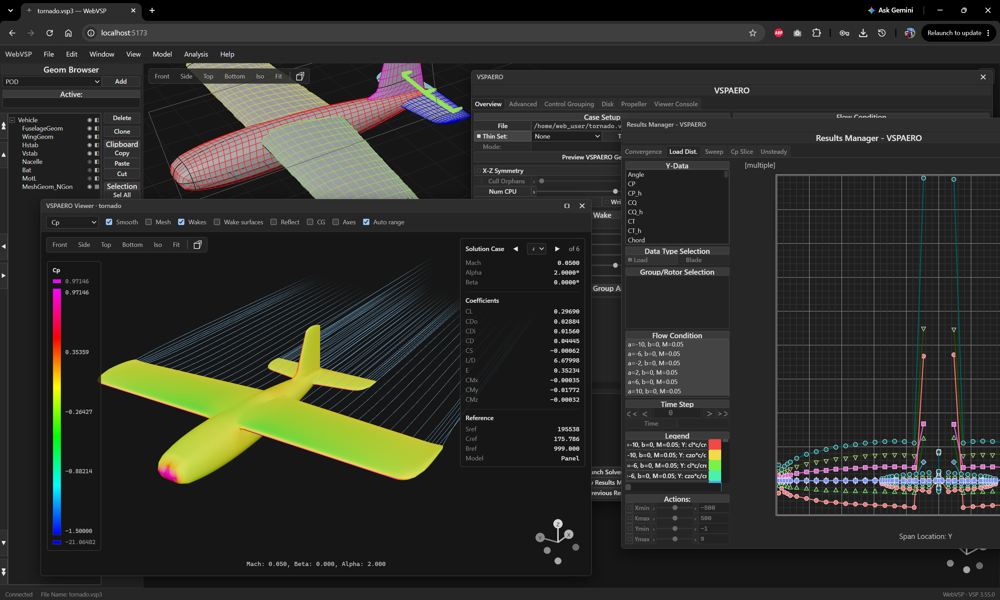
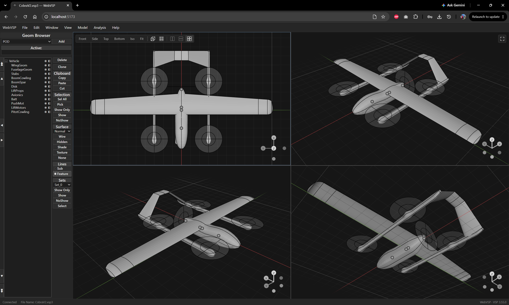

<table width="100%">
<tr>
<td valign="middle" width="220">

</td>
<td valign="middle">

[OpenVSP](https://openvsp.org), NASA's parametric aircraft geometry tool, in a web browser.

**Open it: https://mohammadadib.github.io/WebVSP/**

Nothing to install. OpenVSP and all of its functionality, compiled to WebAssembly, runs in the browser tab on any device that can access the webpage!

</td>
</tr>
</table>

## What you get

- OpenVSP's screens, menus and analyses, including VSPAERO (single-threaded, timed in its
  window's title bar) with a results viewer in the page.
- OpenVSP's plots with their axis numbers and the x / y under the mouse; scroll to zoom, drag to
  pan, double-click to reset.
- A 3D view with orbit, pan and zoom to the cursor, a view toolbar, Blender numpad keys and
  orthographic or perspective views.
- Click to select, Shift- or Ctrl-click to select several, click on nothing to deselect.
- Move arrows on the selection, snapped to a 1-unit grid, with one undo per move.
- Blender's keys for the selection: G to move and R to rotate (X/Y/Z to hold an axis, type a
  value), Shift+D to duplicate, A / Alt+A to select all or none, H / Shift+H / Alt+H to hide
  and show, Z / Shift+Z for wireframe or shaded, X / Delete to delete (it asks first). The
  keyboard button by the 3D view's toolbar lists them all.
- The desktop's selection boxes, cross sections, outlines, CG and other drawings.
- Files are opened and saved through the browser; in Chrome and Edge, Save overwrites the file,
  and VSPAERO's results can be saved next to the model.
  Each tab is its own window with its own model.

Not available yet: STEP export, multithreaded VSPAERO.

See [CHANGES.md](CHANGES.md) for everything WebVSP adds.

## Build and develop

- [web/README.md](web/README.md): building, running and deploying the web app.
- [web/wasm/README.md](web/wasm/README.md): the WebAssembly build of OpenVSP.
- [AGENTS.md](AGENTS.md): how the code fits together, for contributors and coding agents.

To build desktop OpenVSP itself, see the
[OpenVSP repository](https://github.com/OpenVSP/OpenVSP) and its build instructions.

## Source and license

WebVSP is a fork of OpenVSP 3.55.0 ([CHANGELOG.md](CHANGELOG.md) is OpenVSP's history).
Everything outside `web/` is OpenVSP, with small changes for the web app. OpenVSP is available
under the NASA Open Source Agreement (NOSA) version 1.3; see [LICENSE](LICENSE).
